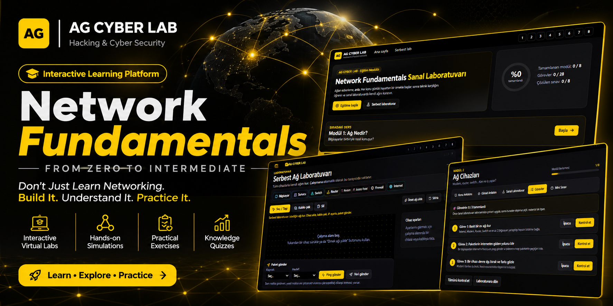
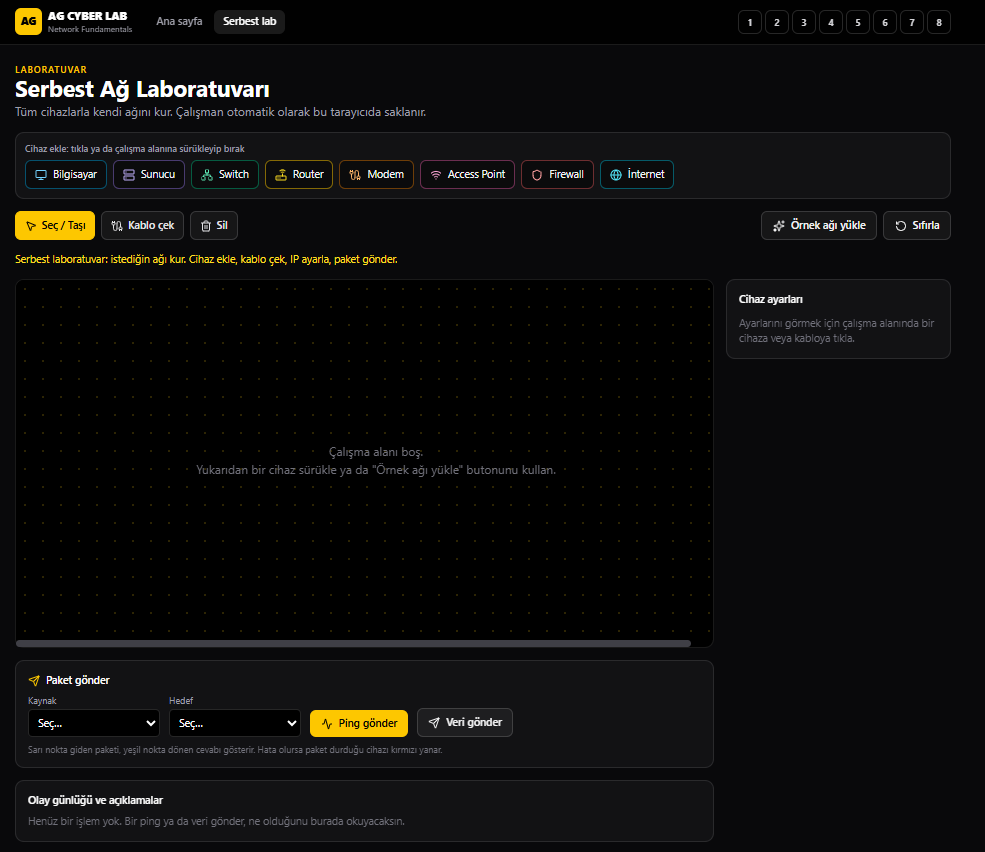
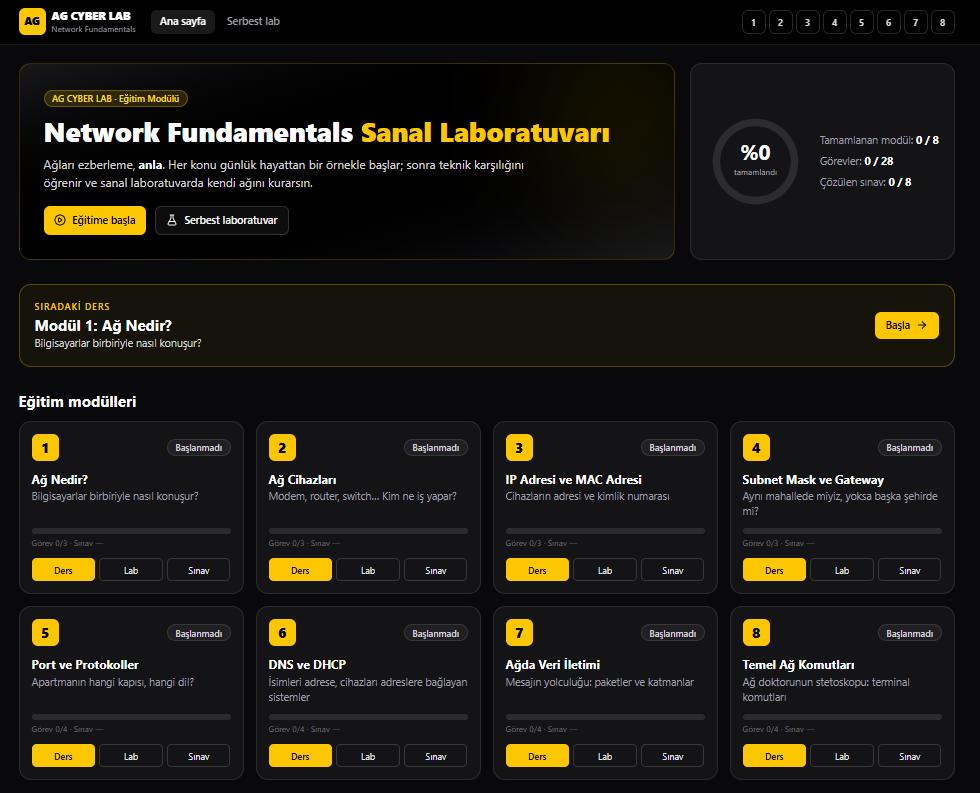
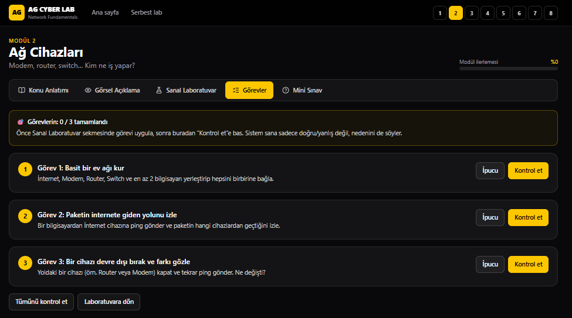

# 🌐 AG CYBER LAB | Network Fundamentals

<p align="center">
  <strong>Interactive Network Learning & Virtual Laboratory</strong>
</p>

<p align="center">
  
</p>

<p align="center">
  <b>FROM ZERO TO INTERMEDIATE</b>
  <br>
  Don't Just Learn Networking. Build It. Understand It. Practice It.
</p>

<p align="center">
  
  
  
</p>

---

## 📌 About The Project

**AG CYBER LAB – Network Fundamentals** is an interactive educational platform designed to teach computer networking from zero to an early intermediate level.

The project combines structured theoretical lessons, visual explanations, interactive virtual laboratories, practical challenges and knowledge assessments.

Instead of memorizing networking concepts, learners are encouraged to understand how networks work by building, configuring and experimenting with their own virtual network environments.

Whether you are a complete beginner or someone looking to strengthen your networking knowledge, this laboratory provides a practical learning path.

## 🎯 Learning Objectives

By completing this learning path, you will develop an understanding of:

- How computer networks communicate.
- How network devices work together.
- How IP and MAC addressing operate.
- How local and remote networks communicate.
- How TCP, UDP and common network protocols work.
- How DNS and DHCP services operate.
- How data travels through network layers.
- How to perform basic network troubleshooting.

## 📚 Course Curriculum

The laboratory consists of 8 structured learning modules.

| # | Module | Topics |
|---|---|---|
| 01 | Network Fundamentals | LAN, WAN, WLAN, Client & Server |
| 02 | Network Devices | Modem, Router, Switch, Firewall |
| 03 | IP & MAC Addressing | IPv4, MAC, DHCP, Static & Dynamic IP |
| 04 | Subnet Mask & Gateway | Network Addressing, Subnet Mask, Gateway |
| 05 | Ports & Protocols | TCP, UDP, HTTP, HTTPS, SSH, DNS |
| 06 | DNS & DHCP | Name Resolution, DHCP, DORA Process |
| 07 | Network Communication | Packets, OSI Model, TCP/IP |
| 08 | Basic Network Commands | Ping, ipconfig, tracert, nslookup, netstat |

## 🧪 Interactive Virtual Laboratory

Learn by building your own virtual network.

The platform includes a dedicated network simulation environment where you can experiment with network devices and observe communication between them.

### Network Topology Builder

<p align="center">
  
</p>

Features:

- Add computers and servers.
- Add switches and routers.
- Add modems and access points.
- Add firewalls and internet nodes.
- Connect devices using virtual cables.
- Configure IP addresses.
- Send simulated network packets.
- Test connectivity using Ping.
- Observe network events and packet results.

### Interactive Learning Dashboard

<p align="center">
  
</p>

The learning dashboard provides:

- 8 structured educational modules.
- Learning progress tracking.
- Module completion status.
- Practical exercise tracking.
- Knowledge assessment progress.
- Quick access to lessons and laboratories.

### Practical Challenges & Exercises

<p align="center">
  
</p>

Each learning module combines theory with practical exercises.

Learners can:

- Complete guided networking tasks.
- Experiment in the virtual laboratory.
- Receive hints when needed.
- Validate their configurations.
- Understand mistakes through explanatory feedback.
- Test their knowledge with module quizzes.

## 🧠 Learning Methodology

The platform follows a simple educational approach:

1. **Understand:** Learn the concept through simple explanations.
2. **Visualize:** See how the technology works.
3. **Practice:** Experiment in the virtual laboratory.
4. **Apply:** Complete practical challenges.
5. **Evaluate:** Test your knowledge through quizzes.

Technical concepts are introduced progressively, using real-world examples to make networking easier to understand.

## 👨‍🎓 Who Is This For?

- Cybersecurity beginners.
- Networking students.
- Aspiring Network Engineers.
- IT support learners.
- Cybersecurity enthusiasts.
- Anyone interested in understanding computer networks.

**No advanced networking experience is required.**

## ⚙️ Installation & Setup

You can run the project locally on your computer.

### Requirements

- Node.js
- npm

### 1. Clone the Repository

```bash
git clone https://github.com/ahmetgulerpy/AG-Network-Fundamentals-Lab.git
```

### 2. Enter the Project Directory

```bash
cd AG-Network-Fundamentals-Lab
```

### 3. Install Dependencies

```bash
npm install
```

### 4. Start the Development Server

```bash
npm run dev
```

### 5. Open the Application

Visit:

```text
http://localhost:3000
```

## 🛠️ Technology

Built with modern web technologies for an interactive educational experience.

- Next.js
- React
- TypeScript
- Tailwind CSS
- Interactive network visualization

## 🔐 Educational Purpose

This project is designed for educational and training purposes.

The virtual network environment provides a controlled space to understand networking concepts, practice configurations and explore network communication.

## 🚀 Project Vision

AG CYBER LAB aims to make cybersecurity and networking education more accessible through practical, interactive and structured learning experiences.

Our philosophy:

**Learn. Explore. Practice. Understand.**

## ⭐ Support The Project

If you find this project useful:

- Give this repository a ⭐ Star.
- Share it with other students and cybersecurity enthusiasts.
- Report bugs and suggest improvements.
- Contribute to the project.

Your support helps make practical cybersecurity education more accessible.

---

## 👨‍💻 Author

<p align="center">
  <strong>Ahmet GÜLER</strong>
  <br>
  Hacking & Cyber Security
  <br>
  AG CYBER LAB
  <br><br>
  <a href="https://github.com/ahmetgulerpy">GitHub Profile</a>
  <br>
  <a href="https://www.instagram.com/ahmetgulerpy/">Instagram Profile</a>
</p>

<p align="center">
  <strong>AG CYBER LAB</strong>
  <br>
  Learn • Explore • Practice
</p>